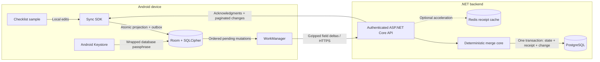

# Resilient Offline Sync Engine

An offline-first synchronization SDK for Android and .NET: durable local mutations, field-level deltas, deterministic conflict resolution, and safe replay after lost acknowledgments.

**Status:** implementation in progress, with a working Android/.NET vertical slice. The backend, portable Kotlin merge core, encrypted Android persistence, GZIP transport, WorkManager orchestration, and native **Fieldlist** checklist sample are implemented. Live tests against Kestrel/PostgreSQL have verified cross-installation convergence, lost-acknowledgment replay, active-request process termination, network reconnection, and recovery after forced Doze and reboot. See [interoperability results](docs/interoperability.md) for exact assertions and limitations, and [PLAN.md](PLAN.md) for remaining acceptance work.

## End-to-End Architecture

These components are implemented. Local verification does not establish production readiness or guaranteed background execution on every Android device.



## Lost-Acknowledgment Recovery

At-least-once delivery is not exactly-once transport. The target guarantee is one durable application of an immutable mutation, even when the client retries after an unknown outcome.

```mermaid
sequenceDiagram
    participant C as Android outbox
    participant A as Sync API
    participant P as PostgreSQL
    C->>A: Push mutation M with immutable payload
    A->>P: Lock workspace cursor; check durable receipt
    A->>P: Commit state, change entry, and receipt atomically
    A--xC: Acknowledgment lost
    Note over C: M remains unresolved across restart
    C->>A: Retry same M and same payload
    A->>P: Read durable receipt and compare payload hash
    P-->>A: Original acknowledgment
    A-->>C: Return original result without applying twice
    C->>C: Atomically mark M synced and preserve newer local edits
```

Redis is a disposable cache, never the replay authority. PostgreSQL receipts survive cache expiry. Per-workspace transactional revisions, not sequence allocation alone, establish safe pull ordering.

## Development

Requires the .NET 10 SDK. From the repository root:

```sh
dotnet build OfflineSyncEngine.slnx
dotnet test OfflineSyncEngine.slnx
```

Tests cover merge convergence, replay-safe component semantics, strict JSON parsing, canonical hashes, signed cursors, and API smoke checks. PostgreSQL-specific tests explicitly skip unless a dedicated test connection is configured. CI supplies PostgreSQL; no passing hosted workflow is claimed before it actually runs.

For Android, install JDK 21 and Android SDK 35; the SDK/sample run on API 26+. Use the checked-in Gradle wrapper:

```sh
./android/gradlew -p android :sync-core:test :sync-android:testDebugUnitTest :sample:assembleDebug
./android/gradlew -p android :sample:installDebug
```

Fieldlist works locally without a connection. To sync, open connection settings, copy the installation's replica ID, and supply a server origin and a JWT bound to that replica and a shared workspace. Use distinct replica IDs on separate installations. See the [development guide](docs/development.md#fieldlist-sample) for setup and identity-binding restrictions.

## Verification Boundary

| Area | Locally verified | Remaining boundary |
| --- | --- | --- |
| Merge and wire contracts | Shared Kotlin/C# fixtures and convergence tests | Seven-day / 10,000-mutation resilience acceptance |
| Android storage and queue | Encrypted reopen, key-failure rejection, atomic edits/responses, fenced leases and retries | Physical-device and OEM coverage |
| Live interoperability | Independent installations converge; replay after lost acknowledgment and active-request termination has one durable effect | Production identity provider/TLS and Redis-outage acceptance |
| Real WorkManager delivery | Process restart, radio reconnection, forced-Doze exit, and reboot recovery | No guarantee while force-stopped, during idle, before unlock, or without app execution |

The staged recovery tests explicitly relaunch instrumentation and use test-only credentials. They are functional emulator tests, not proof of autonomous boot delivery or real-world background timing. Full procedures and recorded results are in the [interoperability guide](docs/interoperability.md). Bandwidth measurements, screenshots, packaging verification, and the remaining resilience scenarios are still outstanding.

## Documentation

- [Development guide](docs/development.md): infrastructure, migration, authentication, running, and testing.
- [Architecture and correctness](docs/architecture.md): merge rules, transaction boundaries, and local projection design.
- [Protocol v1](docs/protocol.md): immutable mutation identities, field deltas, retries, pagination, and errors.
- [Security boundaries](docs/security.md): trust model, operational requirements, and unverified properties.
- [Android/.NET interoperability](docs/interoperability.md): dedicated test backend, multi-installation convergence, and staged recovery tests.
- [Implementation plan](PLAN.md): full scope, phases, acceptance tests, and deferred work.

Documentation is part of the deliverable: architecture diagrams and end-to-end sequences are maintained alongside behavior changes. No measured bandwidth savings, published packages, production-readiness claims, or passing CI badges are invented.