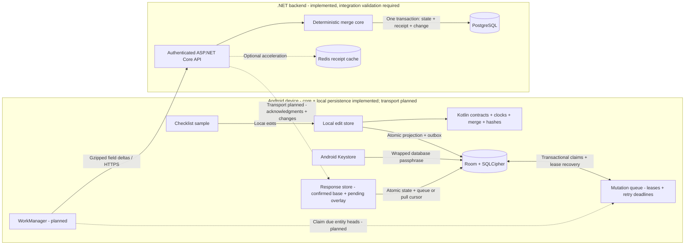

# Resilient Offline Sync Engine

An offline-first synchronization SDK for Android and .NET: durable local mutations, field-level deltas, deterministic conflict resolution, and safe replay after lost acknowledgments.

**Status:** implementation in progress. The .NET backend and portable Kotlin protocol/merge core are implemented. Android has encrypted Room storage, atomic local edits, immutable mutations, fenced queue leases, persisted retries, authentication pause, and transactional acknowledgment/pull application with pending-overlay reconstruction. Eighteen Android 34 instrumentation tests passed locally, including response rollback and newer-edit preservation. Durable server transaction tests require real PostgreSQL; networking/WorkManager, the sample app, and full resilience validation remain outstanding. See [PLAN.md](PLAN.md) for scope and acceptance criteria.

## End-to-End Architecture

This diagram describes the target architecture, not a claim that every component is implemented.



## Lost-Acknowledgment Recovery

At-least-once delivery is not exactly-once transport. The target guarantee is one durable application of an immutable mutation, even when the client retries after an unknown outcome.

```mermaid
sequenceDiagram
    participant C as Android outbox
    participant A as Sync API
    participant P as PostgreSQL
    C->>A: Push mutation M with immutable payload
    A->>P: Lock workspace cursor; check durable receipt
    A->>P: Commit state, change entry, and receipt atomically
    A--xC: Acknowledgment lost
    Note over C: M remains pending across restart
    C->>A: Retry same M and same payload
    A->>P: Read durable receipt and compare payload hash
    P-->>A: Original acknowledgment
    A-->>C: Return original result without applying twice
    C->>C: Atomically mark M synced and preserve newer local edits
```

Redis is a disposable cache, never the replay authority. PostgreSQL receipts survive cache expiry. Per-workspace transactional revisions, not sequence allocation alone, will establish safe pull ordering.

## Development

Requires the .NET 10 SDK. From the repository root:

```sh
dotnet build OfflineSyncEngine.slnx
dotnet test OfflineSyncEngine.slnx
```

Tests cover merge convergence, replay-safe component semantics, strict JSON parsing, canonical hashes, signed cursors, and API smoke checks. PostgreSQL-specific tests explicitly skip unless a dedicated test connection is configured. CI supplies PostgreSQL; no passing hosted workflow is claimed before it actually runs.

The portable Kotlin module requires JDK 21 and runs without an Android device:

```sh
cd android
./gradlew :sync-core:test
```

Both cores consume shared merge, wire, and canonical-encoding fixtures, including Unicode escaping, signed 64-bit precision, and a common SHA-256 mutation fingerprint. These JVM tests do not verify Room, SQLCipher, Keystore, or WorkManager behavior.

With an Android SDK and API 26+ emulator/device, verify encrypted local persistence separately:

```sh
cd android
./gradlew :sync-android:connectedDebugAndroidTest
```

Instrumentation covers encrypted file reopening, ordinary SQLite/wrong-key rejection, missing or corrupt wrapped-key failure without database replacement, account isolation, durable pending edits, monotonic clocks after wall-clock rollback, and transaction rollback on outbox failure. This is not yet an end-to-end synchronizing Android SDK.

Queue tests also exercise competing database handles, expired-lease recovery and stale-worker fencing, persisted retry deadlines and attempts, authentication pause/resume, per-entity blocking without stopping unrelated work, and an encrypted schema v1-to-v2 upgrade. Response tests cover `SYNCED`/terminal acknowledgments, newer pending edits, losing LWW outcomes, cursor fencing, received-clock persistence, counter replay, tombstones, and injected transaction failures. HTTP transport and background delivery are not implemented yet.

## Documentation

- [Development guide](docs/development.md): infrastructure, migration, authentication, running, and testing.
- [Architecture and correctness](docs/architecture.md): merge rules, transaction boundaries, and local projection design.
- [Protocol v1](docs/protocol.md): immutable mutation identities, field deltas, retries, pagination, and errors.
- [Security boundaries](docs/security.md): trust model, operational requirements, and unverified properties.
- [Implementation plan](PLAN.md): full scope, phases, acceptance tests, and deferred work.

Documentation is part of the deliverable: architecture diagrams and end-to-end sequences are maintained alongside behavior changes. No measured bandwidth savings, published packages, production-readiness claims, or passing CI badges are invented.