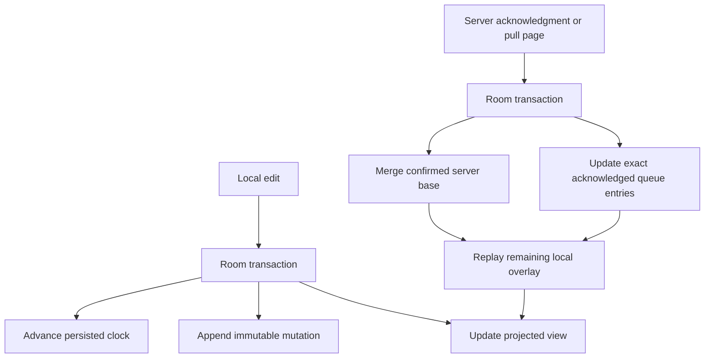

# Architecture and Correctness

## Delivery Versus Application

Clients retry immutable mutations until acknowledged. Transport is at least once; a durable receipt prevents applying a mutation again. There is no claim of exactly-once network delivery.

The PostgreSQL transaction locks the workspace cursor, checks the receipt, merges the mutation, increments the transactional revision, and writes both the receipt and change entry before committing. Redis can accelerate receipt reads but cannot replace this transaction.

## Merge Policies

The .NET and portable Kotlin cores implement immutable states:

| Policy | Merge | Example | Tradeoff |
| --- | --- | --- | --- |
| LWW register | Maximum `(physicalMs, logical, replicaId)` | Title, completion | Clock skew can determine a winner |
| PN counter | Maximum per replica in positive/negative maps | Quantity | Metadata grows with replicas |
| Observed-remove set | Union of add dots and removal dots | Tags | Tombstones retained indefinitely |

Replica IDs and dots use ordinal comparison. A timestamp cannot label different values of the same field, and an add dot cannot label different tag values. Such inputs fail rather than making merge order determine the result. Replica IDs in the protocol are canonical lowercase UUIDs.

PN component values are absolute, nonnegative totals, not increments to apply on every delivery. Sending the same component again is harmless. Integer overflow fails explicitly.

Observed-remove sets track each addition by a unique dot. Removing a tag records only additions already observed. A concurrent addition on another replica therefore survives. A remove delta may arrive before the add it removes: the retained tombstone still suppresses that add.

Hybrid clocks advance from the maximum of local wall time, persisted clock, and received clock. A logical counter preserves ordering when wall time moves backwards. Production ingress must separately validate replica ownership, bounds, and excessive future skew; the pure merge primitives are not an authentication boundary.

## Encrypted Local Projection

`SyncDatabase` uses Room and SQLCipher with a random passphrase wrapped by Android Keystore AES-GCM. Account-scoped database/key material is excluded from backup; missing or unusable keys fail without falling back to plaintext or replacing the database.

Keeping the server base separate prevents a stale response from overwriting a new edit made while a request was in flight. `SyncResponseStore` merges the confirmed base, rebuilds the pending overlay, and advances the pull cursor in one transaction. Push acknowledgments do not advance the pull cursor.

## Transport and Background Delivery

`HttpSyncTransport` uses Retrofit/OkHttp, explicit GZIP request compression, bounded response decoding, and an injectable token provider. HTTPS is required except for explicitly allowed local debug origins. Redirects and implicit connection retries are disabled; the durable queue owns replay.

`SyncRunner` claims immutable payloads through `MutationQueue`, applies acknowledgments using lease-token fencing, and pulls pages through cursor fencing. Retry deadlines and attempts are persisted; authentication failures pause until refreshed credentials are supplied. Protocol/configuration failures surface as actionable background-sync pauses rather than silently discarding work.

`SyncScheduler` enqueues account-scoped connected WorkManager jobs, a periodic recovery sweep, and deadline wakeups. WorkManager is not the queue lock: transactional leases coordinate competing workers. The sample schedules on edits and foreground entry. Delivery still requires Android to execute the app/worker, valid credentials, network access, and a healthy backend.

Fieldlist demonstrates checklist register, counter, tag, and delete operations. Its encrypted connection vault binds the installation to a server/issuer/subject/workspace/replica identity; replacing credentials must preserve that binding. It is a single-identity sample, not a complete account-switching product.

## Validation

Core tests cover deterministic LWW ties, clock rollback, concurrent counter updates, observed removals, late additions, duplicate delivery, and seeded algebraic merge checks against shared fixtures. Android instrumentation covers encryption, transaction rollback, queue fencing, response application, runner behavior, and scheduling.

Live tests use real Kestrel/PostgreSQL and encrypted Android stores. Independent emulator installations converge; staged tests verify lost acknowledgments, termination during an active request, and real WorkManager recovery after process restart, reconnection, forced-Doze exit, and reboot. See [interoperability](interoperability.md) for assertions, results, and explicit limitations. These tests do not prove physical-device/OEM behavior, autonomous boot delivery, production TLS/authentication, Redis outage handling, or the planned seven-day/10,000-mutation scenario.