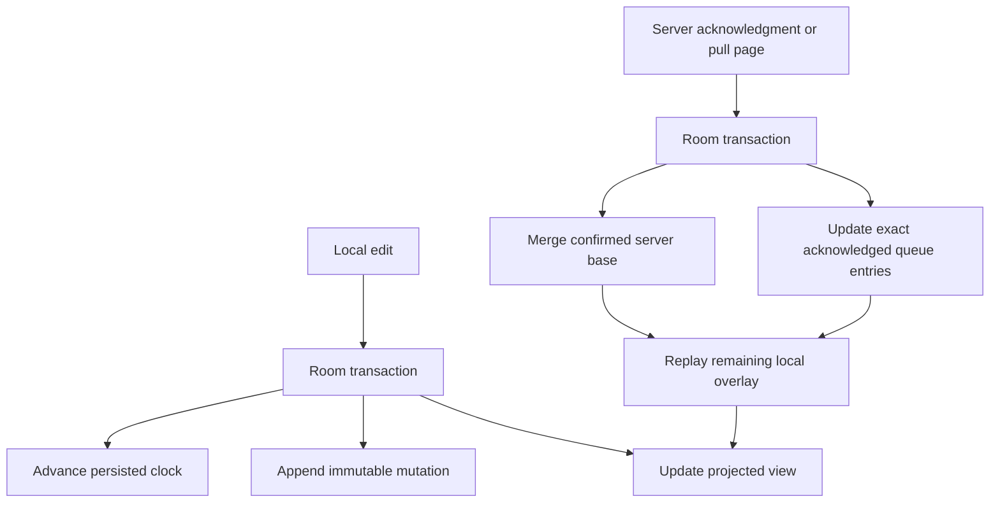
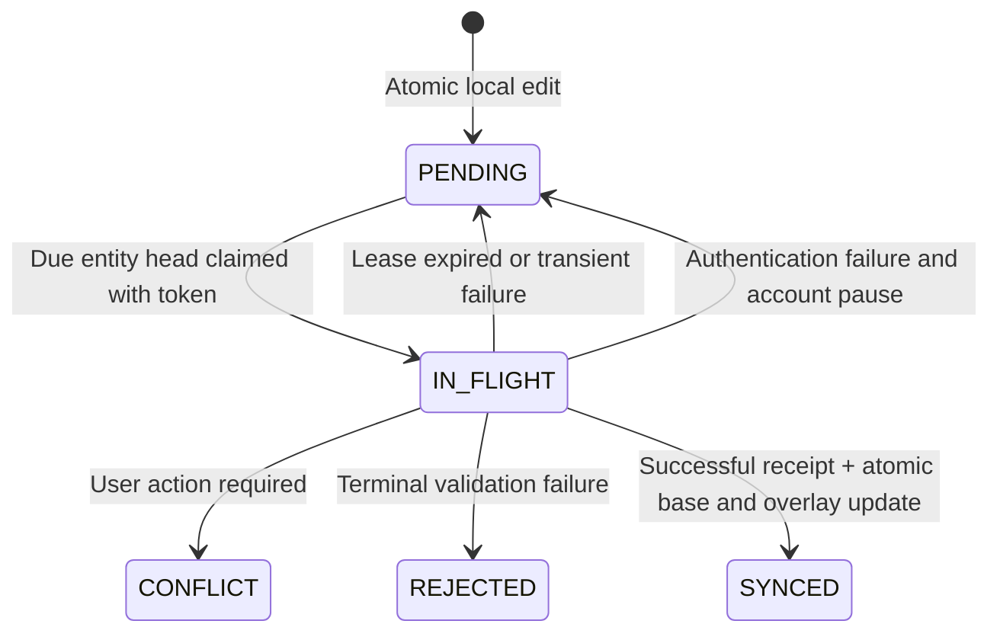

# Architecture and Correctness

## Delivery Versus Application

Clients retry immutable mutations until acknowledged. Transport is at least once; a durable receipt prevents applying a mutation again. There is no claim of exactly-once network delivery.

The planned PostgreSQL transaction locks the workspace cursor, checks the receipt, merges the mutation, increments the transactional revision, and writes both the receipt and change entry before committing. Redis can accelerate receipt reads but cannot replace this transaction.

## Merge Policies

The .NET core implements immutable states:

| Policy | Merge | Example | Tradeoff |
| --- | --- | --- | --- |
| LWW register | Maximum `(physicalMs, logical, replicaId)` | Title, completion | Clock skew can determine a winner |
| PN counter | Maximum per replica in positive/negative maps | Quantity | Metadata grows with replicas |
| Observed-remove set | Union of add dots and removal dots | Tags | Tombstones retained indefinitely |

Replica IDs and dots use ordinal comparison. A timestamp cannot label different values of the same field, and an add dot cannot label different tag values. Such inputs fail rather than making merge order determine the result. Replica IDs in the protocol will be canonical lowercase UUIDs.

PN component values are absolute, nonnegative totals, not increments to apply on every delivery. Sending the same component again is harmless. Integer overflow fails explicitly.

Observed-remove sets track each addition by a unique dot. Removing a tag records only additions already observed. A concurrent addition on another replica therefore survives. A remove delta may arrive before the add it removes: the retained tombstone still suppresses that add.

Hybrid clocks advance from the maximum of local wall time, persisted clock, and received clock. A logical counter preserves ordering when wall time moves backwards. Production ingress must separately validate replica ownership, bounds, and excessive future skew; the pure merge primitives are not an authentication boundary.

## Local Projection

Local-edit and acknowledgment/pull transactions are implemented with separate confirmed/projected records. Network delivery into the response store remains planned.

Keeping the server base separate prevents a stale response from overwriting a new edit made while a request was in flight. Advancing the cursor and applying a page must be atomic.

## Durable Queue

Room transactions select due per-entity heads and assign unique lease tokens and expirations. Another database handle cannot claim an already claimed entry, and a later mutation cannot overtake an unresolved earlier mutation for the same entity. Claims recover expired leases to `PENDING`; payloads and mutation identities never change. Workers must carry the token when reporting failure. An expired or superseded token cannot change queue state.

Transient failures persist exponential backoff with jitter, capped at one hour without retry-count eviction. Authentication failures persist an account pause until credentials are refreshed. Conflict/rejected entries remain visible and block only their own entity. Terminal outcomes rebuild the projection from the confirmed base plus `PENDING`/`IN_FLIGHT` mutations, excluding terminal payloads while retaining them in the queue for diagnosis. Transport and terminal recovery UX remain planned.

Leases coordinate local state, not network delivery: requests can complete after their leases expire. Durable server receipts remain necessary. Wall-clock changes may delay persisted deadlines; hybrid-clock ordering for edits is a separate mechanism.

## Response Transactions

`SyncResponseStore.acknowledge` accepts a receipt only for the matching immutable mutation and current unexpired lease token. Successful receipts merge authoritative server state into the confirmed base, mark the exact entry `SYNCED`, advance the received hybrid clock, and replay active local deltas atomically. Losing LWW writes still become `SYNCED`. Rejected/conflict receipts retain the original payload but remove it from the active projection. Push acknowledgments never advance the pull cursor.

`applyPull` compares the cursor used to fetch the page with the stored cursor inside its transaction. A stale fetch returns false without changes. Revisions must increase beyond the last applied pull revision. Each change merges into the base and replays the pending overlay; the received clock, last pull revision, and opaque next cursor commit together. Invalid pages or database failures roll back all page effects. Server cursors are opaque: the Android store checks local continuity but does not verify the server signature. Account/workspace scoping and trusted authenticated transport remain caller responsibilities.

## Validation

Core tests cover deterministic LWW ties, clock rollback, concurrent counter updates, observed removals, late additions, duplicate delivery, and seeded algebraic merge checks. Eighteen Android 34 instrumentation tests additionally cover encrypted local atomicity, multi-handle claims, lease fencing, retries/authentication pause, migration, newer-edit preservation, response/cursor rollback, clock recovery, counter replay, and delete-wins behavior. Persistent server replay and two-device recovery still require real PostgreSQL/end-to-end acceptance validation.